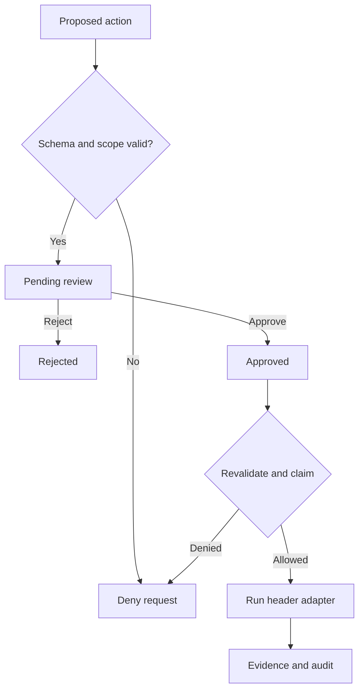

# HoneyAGI (v0.3)

Working foundation for **Design and Implementation of an AI-Assisted Security Assessment Platform with Controlled Tool Execution**.

This version creates scoped assessments, proposes a real HTTP header check, requires a human decision, executes an approved action once, and stores evidence plus a hash-linked audit trail in SQLite. It includes a browser dashboard, retests, JSON reports, a deliberately incomplete demo target, and a hardened comparison target.

**Current scope:** one local operator, one server process, the bundled loopback demo, and either an offline rule-based planner or a configured OpenAI-compatible LLM planner. Offline mode is the default and needs no API key. Remote live planning requires a locally configured provider key. General-purpose scanner workers remain later work.

Day 3 adds the live adapter, explicit configuration, bounded requests, honest provider failures and mode-aware dashboard labels. The adapter has been verified with mocked provider responses and the real local demo; successful live-model verification remains pending because no provider API key was configured. See [provider setup](docs/PROVIDER_SETUP.md) and [day-three notes](docs/DAY_3.md).

Day 2 adds a typed planner interface, bounded/schema-checked planner output, persisted goals and provenance, transactional pending proposals, request replay protection, and a **Generate plan** dashboard workflow. Existing databases are upgraded without deleting day-one assessments, evidence, or audit records. See [day-two implementation notes](docs/DAY_2.md).

## October 14 progress

A repeatable planner verification command now checks pending proposals, approval denials, request replay and report integrity in a disposable database.
It saves redacted results and supports hidden local key entry. JSON-escaped credentials are also rejected before plan storage.
The new tooling is tested; **development Day 4 live-model verification is still pending** because no model/key was configured here.
See [Day 4 notes](docs/DAY_4.md).

After installing the project below, run:

```powershell
.venv\Scripts\python.exe -m app.verify_planner --interactive
```

Enter the model ID and key privately in your terminal. No dashboard/demo needs to be running, no tool is executed, and existing assessments are unchanged.
See [provider setup](docs/PROVIDER_SETUP.md) for compatible endpoints and result/exit-code meanings.

## October 17 progress

Planning can now optionally include compact observations from completed checks: evidence IDs/hashes,
HTTP status and three typed header observations. The dashboard checkbox defaults off. Raw header text
is excluded, retries preserve the original snapshot, and every new proposal still requires approval.
This implements the evidence-context foundation; the offline planner keeps its fixed baseline rules.
**230 tests pass on Windows and Linux**, including 30 new evidence-context cases and a real loopback
demo smoke test with simulated model responses. See [Day 5 notes](docs/DAY_5.md).
Real-model verification remains pending.

## Run locally

1. Clone the repository and open a terminal in its root folder:

   ```powershell
   git clone https://github.com/AkcayFx/honeyagi.git
   cd honeyagi
   ```

2. Create a Python 3.12+ environment and install the project:

   ```powershell
   python -m venv .venv
   .venv\Scripts\python.exe -m pip install -e ".[dev]"
   .venv\Scripts\python.exe run.py
   ```

3. Open <http://127.0.0.1:8000>. Copy the **Access token** printed in your terminal into the dashboard and click **Connect**.
4. Create an assessment with the two default targets. Enter an **Assessment goal** and click **Generate plan**. The rule-based baseline planner proposes one pending header check for each scoped URL without an existing check. Approve a proposal for `/vulnerable` and click **Run check**. You should see three header observations. Repeat for `/hardened`; the three checks should produce no observations. You can also propose a check manually.
5. Choose **View evidence**, **Propose retest**, or **JSON report**. Every retest needs a new approval. Stop both services with Ctrl+C in the terminal.

On macOS/Linux, replace `.venv\Scripts\python.exe` with `.venv/bin/python`.

The launcher checks ports 8000 and 8001, starts the demo as a child process, binds both services to `127.0.0.1`, and cleans up the child on exit. Do not start multiple application workers with the same database: startup recovery assumes a single process.

## Tests

```powershell
.venv\Scripts\python.exe -m pytest -q
```

230 tests cover approvals, exact scope, URL encoding attempts, redirects, concurrent execution claims, retests, token/host/origin boundaries, request and response limits, interruption recovery, evidence redaction, planner output injection, live-provider request/envelope validation, credential exclusion, upstream failures, response limits/cancellation, provider configuration, isolated verification, hidden credential input, decoded secret rejection, concurrent request replay, mid-generation scope changes, database migration, bounded evidence selection, immutable context, evidence opt-in/replay, hostile-text exclusion, and audit/evidence/plan integrity. Most HTTP responses are mocked; the live demo is also checked separately during development. Test data is separate from the application database.

## Automated checks

GitHub Actions runs the regression suite on Windows and Linux with Python 3.12
for pushes to `main`, pull requests, and manual runs. It also checks Python and
dashboard JavaScript syntax, records the tested revision, and verifies that the
offline planner CLI reports its unconfigured state accurately.

The workflow uses read-only repository permissions and pinned action revisions.
Model keys are not required; provider responses in tests remain simulated.
See the [test runs](https://github.com/AkcayFx/honeyagi/actions/workflows/tests.yml).
These checks do not complete the pending real-model verification.

## Project map

| Path | Responsibility |
| --- | --- |
| `app/main.py` | API, token authentication, transitions, report delivery |
| `app/policy.py` | Tool allowlist and exact demo URL scope |
| `app/tools.py` | Header adapter, bounded execution, observations and comparisons |
| `app/db.py` | SQLite transactions, atomic claims, evidence, hash-linked audit |
| `app/models.py` | Strict request schemas; additional fields rejected |
| `app/planning.py` | Planner protocol, fake provider, output validation and orchestration |
| `app/evidence.py` | Bounded, sanitized evidence observations for optional planning context |
| `app/providers.py` | Bounded OpenAI-compatible adapter and explicit provider selection |
| `app/config.py` | Database path, token, fixed local boundaries and planner settings |
| `app/verify_planner.py` | Disposable planning verification and redacted JSON results |
| `app/static/` | Responsive HTML/CSS/JavaScript dashboard |
| `app/demo.py` | Missing-header, configured-header, and redirect targets |
| `run.py` | Start and stop both local services |
| `tests/` | Policy, workflow, and boundary tests |
| `docs/` | Threat model, API examples, milestone roadmap, validation record |

## Controlled execution



Approval and execution are separate requests. There is no shell or arbitrary command field. The only tool is `http_headers`. The executor rechecks scope and claims the approved action in a SQLite transaction before it makes an HTTP request. Replaying the execute request returns a conflict. At most two checks can run concurrently.

Targets must be exact URLs under `http://127.0.0.1:8001`, with one of `/vulnerable`, `/hardened`, or `/redirect`. The policy rejects DNS names, other IPs and ports, credentials, query strings, fragments, percent encodings, and alternate paths. HTTPX ignores proxy environment variables and does not follow redirects.

The adapter makes one streamed GET and does not consume the body. It has a five-second wall-clock limit, accepts at most 32 KiB of response headers after protocol parsing, and stores only the three checked header names with bounded values. It does not retain response cookies or request authentication secrets.

The three checks observe CSP presence, `X-Content-Type-Options: nosniff`, and Referrer-Policy presence. Non-2xx responses are inconclusive. CSP semantic strength, Referrer-Policy semantic strength, exploitable vulnerabilities, and HSTS are outside these checks. Severity labels are review priorities, not CVSS scores or proof of exploitability.

Retests repeat the same immutable target and compare header observations. “No longer observed” means the header observation changed; it is not proof that the application is secure.

## Local configuration

| Variable | Default | Meaning |
| --- | --- | --- |
| `SAP_DB` | `data/assessments.sqlite3` | SQLite file path |
| `SAP_TOKEN` | Fresh random token at every start | Optional fixed token, at least 24 characters |
| `SAP_PLANNER_PROVIDER` | `fake` | Offline baseline or explicitly configured `openai_compatible` |

See [PROVIDER_SETUP.md](docs/PROVIDER_SETUP.md) for model, base URL, key, response format, deadline and token-budget settings. Environment variables must be set explicitly; dotenv files are not auto-loaded.

The dashboard keeps the token in JavaScript memory only. Reloading requires reconnecting. The token is printed intentionally for the local operator; keep the server terminal private. Never commit tokens, `.env`, or assessment data. The provided `.gitignore` excludes them.

The audit is hash-linked and evidence is SHA-256 hashed. Reports verify evidence hashes against completion events as well as the audit chain. This detects ordinary modifications; someone controlling the whole database can rewrite hashes or truncate the log. It is not tamper-proof storage.

See [the API examples](docs/API.md), [threat model](docs/THREAT_MODEL.md), and [roadmap](docs/ROADMAP.md) before extending the project. Official implementation references: [FastAPI lifespan testing](https://fastapi.tiangolo.com/advanced/testing-events/), [HTTPX API](https://www.python-httpx.org/api/), [HTTPX proxy environment handling](https://www.python-httpx.org/environment_variables/).

The offline planner records your goal but supports only a fixed HTTP header baseline. It does not infer arbitrary security procedures from natural language. Generating a plan in either mode never approves or executes its actions. The offline planner skips URLs with any prior check, including rejected or failed ones; use the existing explicit retest flow when appropriate. Exact same-goal request IDs replay a saved result. Changing the goal, assessment, provider or evidence option while reusing an ID returns a conflict.
