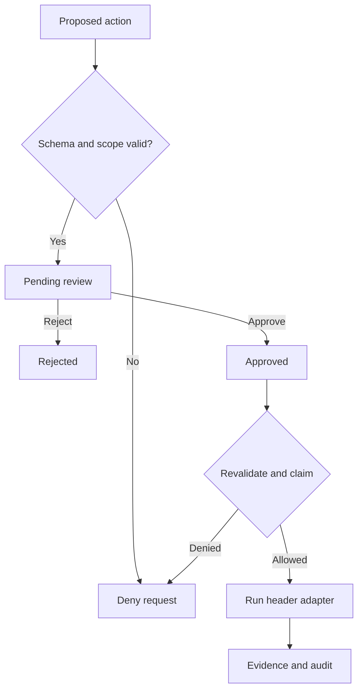

# HoneyAGI — milestone 1

Working foundation for **Design and Implementation of an AI-Assisted Security Assessment Platform with Controlled Tool Execution**.

This version creates scoped assessments, proposes a real HTTP header check, requires a human decision, executes an approved action once, and stores evidence plus a hash-linked audit trail in SQLite. It includes a browser dashboard, retests, JSON reports, a deliberately incomplete demo target, and a hardened comparison target.

**Current scope:** one local operator, one server process, the bundled loopback demo. AI planning and general-purpose scanner workers are milestone 2 work. No API key is needed to run milestone 1.

## Run locally

1. Clone the repository and open a terminal in its root folder:

   ```powershell
   git clone https://github.com/AkcayFx/honeyagi.git
   cd honeyagi
   ```

2. Create a Python 3.12+ environment and install the project:

   ```powershell
   python -m venv .venv
   .venv\Scripts\python.exe -m pip install -e ".[dev]"
   .venv\Scripts\python.exe run.py
   ```

3. Open <http://127.0.0.1:8000>. Copy the **Access token** printed in your terminal into the dashboard and click **Connect**.
4. Create an assessment with the two default targets. Propose a check for `/vulnerable`, approve it, and click **Run check**. You should see three header observations. Repeat for `/hardened`; the three checks should produce no observations.
5. Choose **View evidence**, **Propose retest**, or **JSON report**. Every retest needs a new approval. Stop both services with Ctrl+C in the terminal.

On macOS/Linux, replace `.venv\Scripts\python.exe` with `.venv/bin/python`.

The launcher checks ports 8000 and 8001, starts the demo as a child process, binds both services to `127.0.0.1`, and cleans up the child on exit. Do not start multiple application workers with the same database: startup recovery assumes a single process.

## Tests

```powershell
.venv\Scripts\python.exe -m pytest -q
```

56 tests cover approvals, exact scope, URL encoding attempts, redirects, concurrent execution claims, retests, token/host/origin boundaries, request and response limits, interruption recovery, evidence redaction, and audit/evidence integrity. Most HTTP responses are mocked; the live demo is also checked separately during development. Test data is separate from the application database.

## Project map

| Path | Responsibility |
| --- | --- |
| `app/main.py` | API, token authentication, transitions, report delivery |
| `app/policy.py` | Tool allowlist and exact demo URL scope |
| `app/tools.py` | Header adapter, bounded execution, observations and comparisons |
| `app/db.py` | SQLite transactions, atomic claims, evidence, hash-linked audit |
| `app/models.py` | Strict request schemas; additional fields rejected |
| `app/config.py` | Database path, token, fixed local boundaries |
| `app/static/` | Responsive HTML/CSS/JavaScript dashboard |
| `app/demo.py` | Missing-header, configured-header, and redirect targets |
| `run.py` | Start and stop both local services |
| `tests/` | Policy, workflow, and boundary tests |
| `docs/` | Threat model, API examples, milestone roadmap, validation record |

## Controlled execution



Approval and execution are separate requests. There is no shell or arbitrary command field. The only tool is `http_headers`. The executor rechecks scope and claims the approved action in a SQLite transaction before it makes an HTTP request. Replaying the execute request returns a conflict. At most two checks can run concurrently.

Targets must be exact URLs under `http://127.0.0.1:8001`, with one of `/vulnerable`, `/hardened`, or `/redirect`. The policy rejects DNS names, other IPs and ports, credentials, query strings, fragments, percent encodings, and alternate paths. HTTPX ignores proxy environment variables and does not follow redirects.

The adapter makes one streamed GET and does not consume the body. It has a five-second wall-clock limit, accepts at most 32 KiB of response headers after protocol parsing, and stores only the three checked header names with bounded values. It does not retain response cookies or request authentication secrets.

The three checks observe CSP presence, `X-Content-Type-Options: nosniff`, and Referrer-Policy presence. Non-2xx responses are inconclusive. CSP semantic strength, Referrer-Policy semantic strength, exploitable vulnerabilities, and HSTS are outside these checks. Severity labels are review priorities, not CVSS scores or proof of exploitability.

Retests repeat the same immutable target and compare header observations. “No longer observed” means the header observation changed; it is not proof that the application is secure.

## Local configuration

| Variable | Default | Meaning |
| --- | --- | --- |
| `SAP_DB` | `data/assessments.sqlite3` | SQLite file path |
| `SAP_TOKEN` | Fresh random token at every start | Optional fixed token, at least 24 characters |

The dashboard keeps the token in JavaScript memory only. Reloading requires reconnecting. The token is printed intentionally for the local operator; keep the server terminal private. Never commit tokens, `.env`, or assessment data. The provided `.gitignore` excludes them.

The audit is hash-linked and evidence is SHA-256 hashed. Reports verify evidence hashes against completion events as well as the audit chain. This detects ordinary modifications; someone controlling the whole database can rewrite hashes or truncate the log. It is not tamper-proof storage.

See [the API examples](docs/API.md), [threat model](docs/THREAT_MODEL.md), and [roadmap](docs/ROADMAP.md) before extending the project. Official implementation references: [FastAPI lifespan testing](https://fastapi.tiangolo.com/advanced/testing-events/), [HTTPX API](https://www.python-httpx.org/api/), [HTTPX proxy environment handling](https://www.python-httpx.org/environment_variables/).
